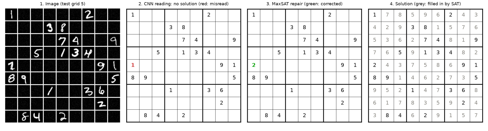

# sudoku-vision

Reads an image of a sudoku with handwritten digits, recognizes each cell with a small convolutional network, and solves the puzzle with a SAT solver. When the network misreads a digit, logic repairs the reading: MaxSAT finds the most probable reading, according to the network, that obeys the sudoku rules and has exactly one solution.

Builds on [sudoku-sat](https://github.com/ysmouhib/sudoku-sat).



## Results

1,000 test puzzles drawn with MNIST test digits, which were never seen in training. Mean over 3 training seeds.

| Classifier | Grid read perfectly | Correct after repair | Wrong | Timed out | Flagged |
|---|---|---|---|---|---|
| Linear | 11.4% | 63.0% | 12.0% | 21.9% | 3.0% |
| MLP | 52.6% | 97.0% | 2.5% | 0.5% | 0.03% |
| CNN | 75.4% | 99.0% | 0.97% | 0% | 0% |

*Timed out:* the repair hit its 10 s budget per grid. *Flagged:* the repair tried 20 readings without finding one with exactly one solution.

## Findings

- **Errors compound.** A grid is read correctly only if all 81 cells are, so even the CNN reads only 75% of grids perfectly.
- **Logic repairs most errors.** Taking the network's probabilities rather than its best guesses, and requiring exactly one solution, takes the CNN from 75.4% to 99.0% of grids.
- **What logic cannot catch.**
  - Let P be a puzzle with a unique solution. A blank read as a wrong digit always makes P unsolvable, and a clue read as blank can only add solutions.
  - So the only undetectable error is a clue read as another digit that gives a different unique solution. That's 2.36% of such substitutions in minimal puzzles, and 3.47% in puzzles with 30 clues (a census of 200 puzzles of each kind).
  - When removing the clue leaves exactly two solutions, exactly 1 of the 8 substitutions is undetectable.
- **The truth is the runner-up.** In all 10 wrong CNN answers on test[^1], the most probable reading with a different unique solution gave the true solution. Flagging answers whose probability margin is below a threshold chosen on validation catches 8 of the 10, and flags 3.4% of correct answers.
- **Temperature scaling cannot change the repair.** Under temperature T, the cost of a reading is (1/T)·(−Σ logits) plus a constant, so every T > 0 ranks the readings in the same order. The test run confirms it[^2].

## Run it

Python 3.14. For the GPU build of PyTorch (CUDA 12.6), install it first; skip this line for the CPU build:

```
pip install torch==2.10.0 torchvision==0.25.0 --index-url https://download.pytorch.org/whl/cu126
pip install -r requirements.txt
python train_digits.py
python generate.py
python grids.py
python read_grids.py val
python read_grids.py      # test grids; delete results/reading_outcomes.csv first, or it won't rerun
python repair.py val
python repair.py          # test grids, about 75 minutes
python calibrate.py
python undetectable.py
python demo.py
python export_onnx.py
python -m pytest
```

`read_and_solve(image)` in `solve_image.py` runs the whole pipeline on one image. `export_onnx.py` exports the CNN to ONNX and checks the export against PyTorch.

## Limitations

- The images are synthetic: MNIST handwriting pasted into clean grids. Real photos need grid detection and printed digits; see `docs/app-notes.md`.
- The repair budget is measured in seconds, so the number of timeouts varies a little between runs.

[^1]: CNN, seed 0 only, on the same 1,000 test grids; the table averages 3 seeds.
[^2]: MLP and CNN, 3 seeds each (6,000 grid runs): no answer changed between right and wrong. Three MLP grids near the 10 s budget timed out in one run but not the other. The linear model was not rerun.
